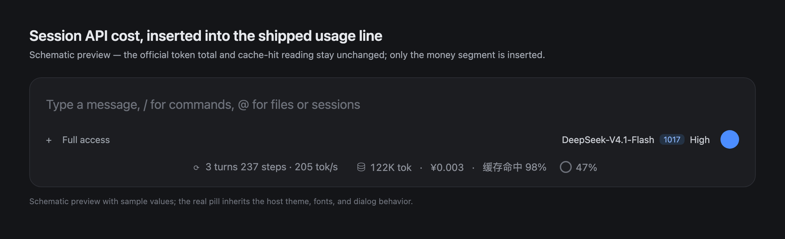

# dsh-session-cost

**Session API cost inside the DSH composer usage line — and inside the Agent Teams roster.** It
keeps the official token count and cache-hit reading byte-identical to the shipped pill and inserts
the money segment between them:

```
⟳ 3 turns 237 steps · 205 tok/s    🗄 122K tok · ¥0.003 · 缓存命中 98%    ◔ 47%
                                    ↑ shipped usage pill with the API cost inserted
```



The token dialog keeps its shipped rows and adds **消费金额** (cost), **价格表** (price-table
snapshot / newest applied revision) and **价目自动检查** (last official-page check). A failed check
marks the amount with `!` and shows a dismissible notice.

### Agent Teams roster

When the experimental Agent Teams bundle is enabled
(`@deepseek-ai/dsh-experimental-agent-team-profile`), the same plugin also annotates the shipped
conversation-header team panel, without replacing it:

- every roster card shows that member Session's own cumulative API cost at its right edge;
- the roster heading (`成员 N`) shows the sum over every member, the Lead included.

Costs for teammates are read from each teammate Session's own `sessionCost` projection, so the Lead
amount and every helper amount are independent bills. A **forked** teammate inherits a copy of the
Lead's completed history; its card shows only the cost the member itself produced, and the inherited
prefix is excluded from the team total (the card's hover text reports the excluded amount) so the
Lead's earlier spend is never counted twice. A teammate whose conversation is not open has no live
projection frames; the plugin asks the Session service to refresh all member projections when the
panel opens and every 15 seconds while it stays open. An unknown or differently-priced member is
excluded from the sum and the total is marked `≈`; hovering a reading shows the exact amount and any
price-table caveat. The integration targets the 0.2.1-rc.5 experimental panel; a DSH build without
that panel simply never shows the decoration.

> This is a third-party plugin. It is not an official DeepSeek / DeepSeek Harness component.
> The amount is a **token cost** (official billed tokens × official published prices) — a lower
> bound of real spend, not an official invoice.

## Install

Requires **DSH 0.2.1-rc.2 or newer (below 0.3.0)** with the Web/Desktop surface, and Node ≥ 22.
Verified on DSH 0.2.1-rc.5, including a live run with the experimental Agent Teams profile; the
DSH 0.2.1-rc.2 API surface was checked statically (projection wire views, slot shadowing, locale
registration, session-list projections).

- **Plugin Manager:** Plugins → Add → `@ceasarxuu/dsh-session-cost` → install and keep it enabled.
- **CLI:** `dsh plugin --profile <profile> add @ceasarxuu/dsh-session-cost`

A fresh install starts working immediately: it replaces the composer `usage` cell, and on first
load it performs the first official price check. Disable the bundle and the shipped pill returns
unchanged. `plugin_manager` `install_bundle` accepts the same package name/spec.

## What it shows

| Segment | Source |
|---|---|
| `<n> tok` | the official `tokenUsage` session projection (unchanged) |
| `¥0.003` / `$0.16` | this plugin: the same billed token buckets × official prices, per request |
| `缓存命中 98%` | the official cache-hit rule (unchanged, including the never-round-to-100% behavior) |
| team card `¥0.18` | this plugin: that member Session's child-owned `sessionCost` portion |
| team heading `合计 ¥0.42` | this plugin: Σ child-owned cost over `agentTeam.members` (Lead included) |

The money segment hides itself when no price is configured for the route (for example a
third-party provider); the dialog then says “未配置价格” instead of inventing a number. A gateway
that renames the model (for example `opencode-go/deepseek-v4.1-flash` while the official API id is
`deepseek-flash`) stays unpriced until you add a matching row — `*/deepseek-v4.1-flash` resolves any
provider's model with that id.

## How the amount is computed

The host half registers a `sessionCost` session-projection unit that folds the exact events the
official `tokenUsage` unit folds (`assistant/message` / `assistant/attempt` usage samples,
`llm/retry-started` replacement semantics), so the amount always belongs to the tokens next to it.

- **Per sample, per route:** each sample is attributed to its model
  (`assistant/message.data.message.source`); a retried attempt inherits the latest
  `request/header` route.
- **Per sample, per tariff:** official DeepSeek prices are peak/off-peak. Peak is exactly 2× off-peak
  and applies Beijing Mon–Fri 09:00–12:00 and 14:00–18:00, excluding Chinese statutory holidays.
  Each sample uses the tariff of its own request-start time.
- **Per sample, per price revision:** the price table is dated history, so a session recorded before
  an official price change keeps the old rate.
- **Exact integer arithmetic** in nano-currency units:

  ```
  cost_nano = Σ samples ( uncachedInput×miss + cacheRead×hit + cacheWrite×miss + output×output ) × tariff
  cost      = cost_nano / 1e9
  ```

  `reasoningTokens` are already inside `outputTokens`; `totalTokens` is ignored (the buckets are
  disjoint).

The result is session-cumulative over the whole durable log, including fork-inherited prefixes. The
wire view also carries the child-owned split (`ownCostNano` / `ownUnpricedTokens`), which counts only
events at or past the fork's inherited cut (`init(header, inheritedEventCount)`).

For an Agent Team, every member (the Lead included) is its own durable Session with its own log, so
the team total is the sum of every member's child-owned cost. A forked teammate's inherited prefix is
kept out of that sum, which is why the card on a fork reports the member's own amount and its hover
text names the excluded inherited total. The plugin reads the shipped `agentTeam` projection
(`members[].id`) and the Session store's `projectionsBySession`; it adds no Team RPC and never
re-allocates the Lead's tokens.

> While a teammate Session is not open, its projection value is only as fresh as the last refresh.
> The roster decoration refreshes all members when the panel opens and every 15 seconds while it is
> open; closing the panel leaves the last known amount, and the next open refreshes it again.

## Price updates and the auto check

Official prices change over time. The plugin:

- ships the official off-peak snapshot of 2026-10-28 (CNY and USD tables), and
- fetches the official pricing page **at most once per 7 days** (`autoCheck.intervalDays`),
  parses it fail-closed (rowspan-aware table parsing, currency-marker validation, plausibility
  checks, evidence-based peak multiplier) and:
  - records the check timestamp when prices are unchanged;
  - appends a **new price revision dated today** for changed models when the validated page differs,
    then re-registers the projection so new requests use the new rate while old sessions keep the
    old one;
  - reports a failure (instead of silently changing anything) when the fetch or parse fails, or
    when the official peak multiplier no longer matches the configured tariff. The UI then shows the
    `!` marker, a “失败 / 建议手动核对” dialog row, and a dismissible frame-wide notice.

Peak windows and the Chinese holiday calendar cannot be derived from the pricing page — update
`tariffs.holidays` yearly. Manual helpers:

```sh
node scripts/refresh-prices.mjs   # read-only: fetch both pages, diff against the config, print a
                                  # paste-ready dated revision block; exit 1 on failure
```

The check state lives in `~/.dsh/plugin-data/session-cost/price-state.json` (override with
`config.statePath`). Delete it to make the next start check again.

## Configuration

Defaults are in the bundle's `cordis.patch.yml`; override them in your profile's
`cordis.patch.yml` (a patch for row id `session-cost` replaces the whole `config`, so restate every
key you need). HMR recomposes without restarting Desktop.

| Key | Default | Meaning |
|---|---|---|
| `currency` | `CNY` | Display currency; `CNY` and `USD` tables ship with the plugin. Prices are never FX-converted. |
| `prices` | official snapshot | Dated revisions per currency/model: `{ from, hit, miss, output }` per 1M tokens, off-peak. |
| `pricesAsOf` | `2026-10-28` | Snapshot label shown in the dialog. |
| `tariffs` | official schedule | `peakMultiplier`, `utcOffsetMinutes`, `peakWindows`, `weekdays`, `holidays`. |
| `autoCheck` | `{ enabled: true, intervalDays: 7 }` | Bounded official-page check; `intervalMs` overrides the interval. |
| `pricingUrls` | official docs | Page per currency. |
| `statePath` | `~/.dsh/plugin-data/session-cost/price-state.json` | Persisted check state / auto revisions. |

Routes resolve by `provider/model`, then `*/model`, then bare `model`.

## Privacy and network

- One HTTPS GET to `api-docs.deepseek.com` at most once per 7 days. No API keys, no session content
  and no prompts are sent.
- No telemetry.
- Local state is limited to the check timestamps, auto-detected price revisions and a
  localStorage dismissal key in the Web UI.
- All numbers are computed locally from your session log and the price table.

## Known limits

- **Lower bound, not an invoice:** auxiliary calls that the official `tokenUsage` fold does not
  log (compaction summaries, session-title calls, auxiliary web-search model calls, Search/Fetch
  fees) are excluded on purpose.
- **Price history starts at the shipped 2026-10-28 snapshot.** Earlier official prices were not
  published in a machine-readable history here, so nothing is fabricated; every change detected
  from now on is preserved as a dated revision.
- **Peak windows / holidays are manual** (yearly refresh). A peak-multiplier change is detected and
  reported for manual review.
- **Unpriced routes** (third-party providers without official prices) show the token reading and a
  `≈`/“未配置价格” marker. Team member and total readings inherit the same marker.
- **Forked teammates:** a fork's inherited prefix is excluded from its roster amount and from the
  team total (hover shows the excluded inherited amount). Opening that teammate's own conversation
  still shows its whole-log cumulative amount in the composer pill, because that reading is defined
  over the full durable log.
- **Agent Teams decoration is DOM-based.** The shipped team panel exposes no sub-slot, so the
  plugin attaches its two cost nodes to the panel's roster section (`[data-team-panel]`). A DSH
  release that renames that attribute or restructures the roster needs a plugin update; the panel's
  own roster, task board and teammate navigation are untouched, and the composer pill is unaffected.
- **DSH internal APIs:** this plugin relies on session projections, slot shadowing, locale
  registration, session-list projections and the Agent Teams panel's DOM contract. It is
  version-gated by `engines.dsh`; a DSH upgrade below 0.3.0 future-versions may still require an
  update.
- Historical sessions before a price change keep the old revision only after the plugin has
  recorded both revisions; the initial snapshot cannot reconstruct unknown past prices.

## Development

Plain JavaScript, no build step, no runtime npm dependencies.

```sh
node test/prices.test.mjs       # 33 fail-closed parser/fetch tests against real-page fixtures
node test/host-fold.test.mjs    # 12 host fold + fork split + auto-check tests (offline, local HTTP fixture)
node test/client-team.test.mjs  # Agent Teams aggregation, formatting and panel decoration (fake DOM)
node --check index.js && node --check client.js
npm pack --dry-run             # inspect the packed file list
```

Layout: `index.js` host half (projection + price check), `client.js` browser half (pill + dialog +
notice + team-panel decorator), `prices.js` official-page parser/fetcher, `cordis.patch.yml`
defaults, `scripts/` manual price diagnostics, `test/` suites and fixtures, `locale/` Plugin Manager
metadata.

## License

MIT — see [LICENSE](LICENSE). Portions of the UI are derived from DeepSeek Harness (MIT); see
[THIRD_PARTY_NOTICES.md](THIRD_PARTY_NOTICES.md). Chinese README: [README.zh.md](README.zh.md).
